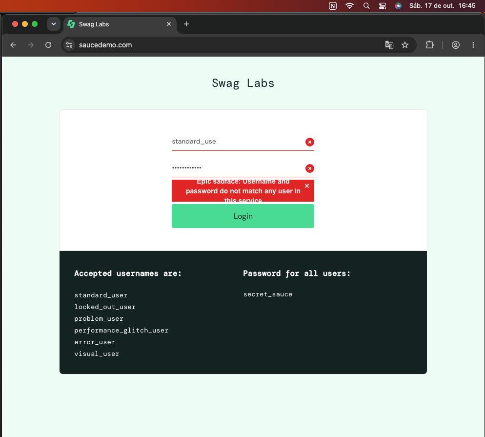
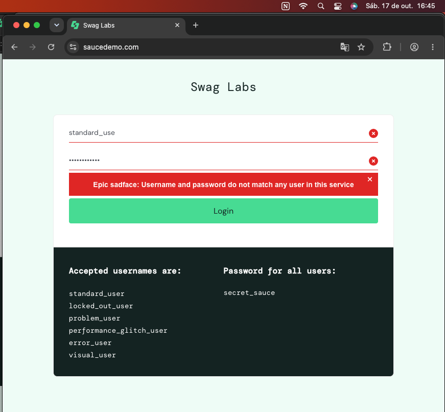
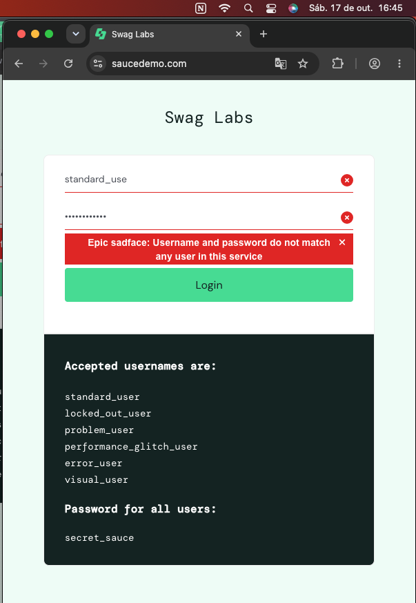
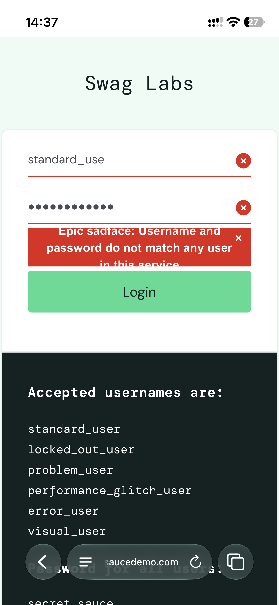
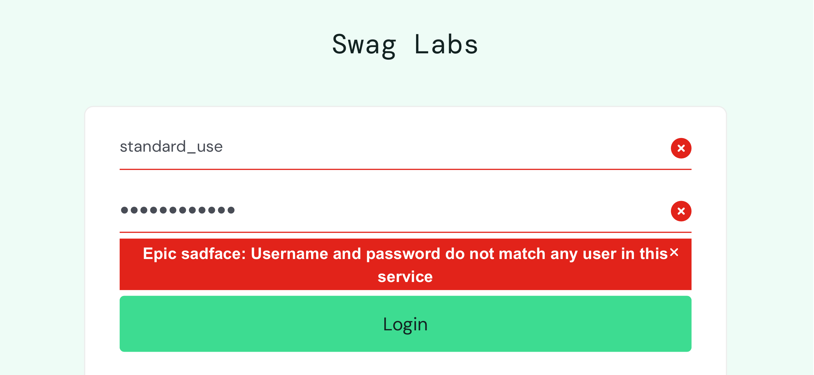
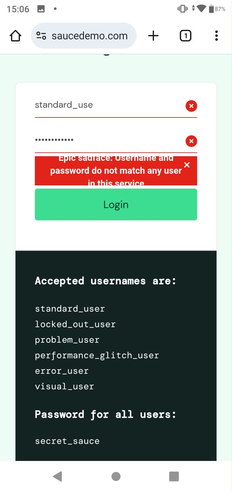
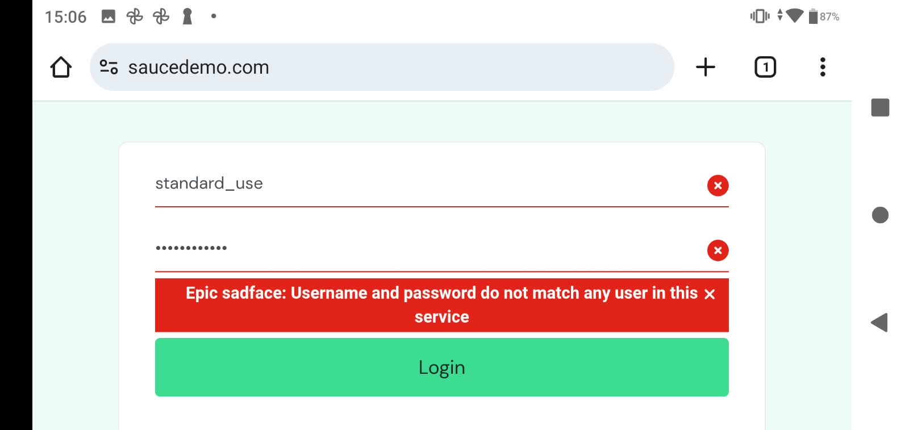

# BUG-003 | Mensagem de erro parcialmente oculta no login

[Início](../../README.md) / [Defeitos](README.md) / BUG-003

**Aplicação:** SauceDemo
**Módulo:** Login
**Tipo:** Interface / responsividade
**Status:** Aberto
**Severidade sugerida:** Baixa
**Prioridade sugerida:** Média

## Rastreabilidade

- Caso de teste: [SD-CT-16](../casos-de-teste/SD-CT-16.md)
- Execução: [SD-EX-16](../execucoes/SD-EX-16.md)
- Descoberta inicial: [SD-CT-09](../casos-de-teste/SD-CT-09.md)

## Pré-condições

Acessar a página de login em uma janela desktop larga.

## Passos para reproduzir

1. Acessar https://www.saucedemo.com/
2. Informar o usuário `standard_use`.
3. Informar a senha `secret_sauce`.
4. Clicar em Login.
5. Observar a apresentação da mensagem de erro.
6. Reduzir a largura da janela e comparar o resultado.

## Resultado esperado

A mensagem de erro deve permanecer integralmente legível, sem cortes ou sobreposição de elementos, nas larguras suportadas.

## Resultado observado

Em determinadas larguras de janela desktop, parte da mensagem de erro fica oculta.

Ao reduzir a largura, a mensagem passa a ser exibida corretamente.

## Navegadores testados

- Google Chrome
- Microsoft Edge
- Safari
- Vivaldi

O comportamento foi reproduzido nos quatro navegadores.

## Evidências

Foram registradas três capturas comparativas, demonstrando o comportamento da mensagem de erro em diferentes larguras de janela.

As imagens estão disponíveis na seção Comparação visual.

As três capturas anexadas foram realizadas no Google Chrome. O comportamento também foi reproduzido manualmente no Edge, Safari e Vivaldi, sem registros visuais desses navegadores.

## Limitações da investigação

- Larguras exatas da viewport não medidas.
- Versões de todos os navegadores não registradas.
- Causa técnica não identificada.

## Observação

O defeito visual não impediu a rejeição das credenciais inválidas. Por isso, o teste funcional SD-CT-09 permanece aprovado.

## Comparação visual

**Janela larga: comportamento incorreto**

**Janela intermediária: comportamento correto**

**Janela estreita: comportamento correto**

## Investigação complementar em dispositivos móveis

### Ambientes e condições

- iPhone 13 mini, iOS 27.0.1, Safari, tela de 5,4".
- ASUS Zenfone Max Shot, Android 9, Chrome, tela de 6,26".
- Orientações testadas: vertical e horizontal.
- Credenciais: usuário `standard_use` e senha `secret_sauce`.

### Resultado observado

Em ambos os dispositivos, após a tentativa de login com usuário inválido, a aplicação apresenta a mensagem de erro de autenticação.

Na orientação vertical, o conteúdo da mensagem aparece parcialmente cortado, prejudicando sua leitura. Na horizontal, a mensagem fica mais legível, embora haja possível problema de espaçamento próximo ao ícone de fechar.

O comportamento visual foi observado em dois ambientes móveis. Ainda não foi confirmada uma causa técnica comum à ocorrência desktop.

### Evidências mobile

**iPhone 13 mini, Safari, vertical**

**iPhone 13 mini, Safari, horizontal**

**Android, Chrome, vertical**

**Android, Chrome, horizontal**

### Limitações da investigação mobile

- Dimensões exatas das viewports não medidas.
- Causa técnica não identificada.
- Não foi comprovado que as ocorrências desktop e mobile tenham a mesma causa raiz.

---

[← Voltar ao índice de defeitos](README.md) | [README principal](../../README.md)
